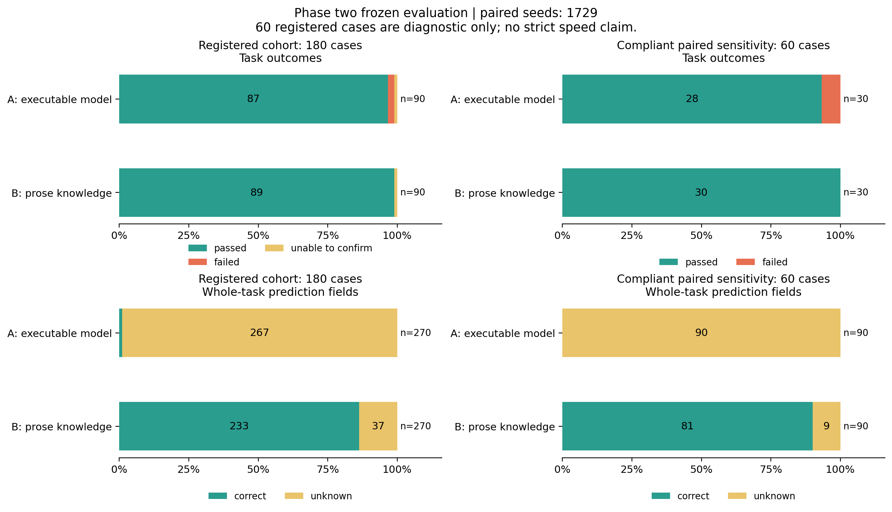

# 第二阶段实验报告

本轮已完成 6 个独立浏览器学习包的冻结和登记的 180 个首次评测案例，按固定分母汇总 540 个整任务预测字段。独立审查允许 4 个包进入第三阶段，隔离 2 个包。第三阶段尚未执行。

这里的完成指登记协议下的学习、冻结测试、独立核验和交接归档完成，不代表全站业务已被理解，也不是官方基准成绩。

## 实验设置

| 项目 | 实际设置 |
| --- | --- |
| 站点 | 本地 Discogs 派生站点，phase2-routing-v002；源码、构建、依赖及基线哈希分别登记 |
| 学习者及执行者 | 独立 gpt-6.1-sol，high reasoning；隔离进程与独立上下文 |
| 条件 A | 自然语言规则、可执行行为预测模型、原生 Playwright 脚本 |
| 条件 B | 自然语言规则、原生 Playwright 脚本；不含可执行预测模型，保留相同 LLM 监督 |
| 划分 | 种子 1729、2718、3141；每个种子各 A/B 一轮，每轮 30 个评测案例 |
| 学习预算 | 每轮最多 300 个 UI 动作、40 次浏览器执行、7200 秒 |
| 评测预算 | 每例最多 60 个 UI 动作、20 次浏览器执行、900 秒模型窗口；单脚本 300 秒、原生操作 30 秒 |
| 动作接口 | 直接 Playwright；动作前预测、目标确认、滚动、操作、等待及回读证据 |
| 信息边界 | DOM/属性、可见状态、截图及协议允许的网络信息；不继承目标源码、白盒规则或测试答案 |
| 账号与权限 | 沿用协议登记的普通测试账号及冻结权限；凭据不写入报告 |
| 固定预测字段 | disposition、persistent_state_changed、affected_record_count |
| 评测监督 | 每例新上下文，只给当前任务与自身只读学习包；不将前例反馈传入下一例，不在线修订冻结知识 |

六个学习包全部冻结后才派发第一个私有评测任务。种子用于任务调度，不冒充模型采样种子；采样种子未设定。管理方负责环境、隔离、调度与记录；目标建模及脚本由实验模型产出，独立评估方维护真值，模型自述不作为唯一正确性证据。

## 学习产物与独立准入

| 学习包 | 实际 UI 动作 | 浏览器执行 | 规则声明数 | 冻结版本 | 第三阶段准入 |
| --- | ---: | ---: | ---: | --- | --- |
| a-seed-1729 | 44 | 10 | 17 | [revisions/002](../runs/a-seed-1729/workspace/revisions/002/rulebook.md) | 允许 |
| b-seed-1729 | 286 | 40 | 47 | [revisions/r004](../runs/b-seed-1729/workspace/revisions/r004/rulebook.md) | 允许 |
| a-seed-2718 | 3 | 2 | 3 | [revisions/r003](../runs/a-seed-2718/workspace/revisions/r003/rulebook.md) | 隔离 |
| b-seed-2718 | 50 | 11 | 23 | [revisions/r004](../runs/b-seed-2718/workspace/revisions/r004/rulebook.md) | 允许 |
| a-seed-3141 | 300 | 36 | 45 | [revisions/r002](../runs/a-seed-3141/workspace/revisions/r002/rulebook.md) | 隔离 |
| b-seed-3141 | 214 | 40 | 35 | [revisions/r002](../runs/b-seed-3141/workspace/revisions/r002/rulebook.md) | 允许 |

规则数是学习者声明条数。结构完整、语法通过和有限任务成功均不等价于完整业务覆盖。A2718 与 A3141 在静态策略拒绝后继续执行，违反学习停止约定；未发现实际隔离逃逸的结论不能消除这一协议违规。两包的 60 个原始评测案例保留为诊断数据，不能作为两轮合规重复，也不能交给第三阶段学习者。

本轮 broker 对派发前的静态拒绝没有完整的停止锁存及事件日志。独立审查据原始 CLI 顺序追溯了继续执行，缺失的拒绝绝对时间未补造；该管理缺陷及学习者停止违规均保留在偏差记录中。

## 原始登记结果

| 条件 | 任务成功／固定分母 | 预测正确／固定分母 | 预测错误 | 未知 | 不可评分 | 预测覆盖率 |
| --- | ---: | ---: | ---: | ---: | ---: | ---: |
| A | 87/90 | 3/270 | 0 | 267 | 0 | 1.1% |
| B | 89/90 | 233/270 | 0 | 37 | 0 | 86.3% |

未知不计为正确。预测覆盖率是（正确＋错误）／固定字段分母；预测正确率以全部登记字段为分母。业务拒绝可能正是任务要求，不能把 rejected 直接记成任务失败。任务是否成功、是否发生业务变化、预测是否正确分别报告。

| 学习包 | 任务成功／30 | 正确／90 | 错误 | 未知 | 不可评分 | 实际 UI 动作 |
| --- | ---: | ---: | ---: | ---: | ---: | ---: |
| a-seed-1729 | 28/30 | 0/90 | 0 | 90 | 0 | 364 |
| b-seed-1729 | 30/30 | 81/90 | 0 | 9 | 0 | 334 |
| b-seed-2718 | 29/30 | 71/90 | 0 | 19 | 0 | 397 |
| a-seed-2718 | 30/30 | 0/90 | 0 | 90 | 0 | 539 |
| a-seed-3141 | 29/30 | 3/90 | 0 | 87 | 0 | 328 |
| b-seed-3141 | 30/30 | 81/90 | 0 | 9 | 0 | 456 |

## 合规配对敏感性分析

按照独立合规审查选取的配对种子：1729。该视图共 60 例、180 个字段，选择依据是协议合规性，不是分数。它不替换原始 180/540 分母。

| 条件 | 任务成功／固定分母 | 预测正确／固定分母 | 预测错误 | 未知 | 不可评分 | 预测覆盖率 |
| --- | ---: | ---: | ---: | ---: | ---: | ---: |
| A | 28/30 | 0/90 | 0 | 90 | 0 | 0.0% |
| B | 30/30 | 81/90 | 0 | 9 | 0 | 90.0% |

当前合规重复数量有限，不能据此宣称稳定的方法优势或泛化到未测试业务范围。

## 并发、基础设施与耗时解释

用户要求提速后，准备了最多 12 个独立实例。新增实例的首次 UI 验收失败与管理端口映射问题均保留；并行验收中观察到 h 触发宿主 3 GiB 内存保护并退出；后续从原始终端捕获确认 a/b/c 也因该保护退出。新正式案例在派发前被健康检查拦下，发现服务退出并开始恢复时，已有 21 例封存、无在途正式模型；原结果未覆盖。原始终端捕获并非完整磁盘日志，具体退出时刻未能确定。

恢复 a..f 六个实例后，暂停 g..l。新调度每次领取案例前检查登记前后端端口，同时保留 Windows 4 GiB、WSL 2 GiB 的派发门槛。恢复 a/b/c 前后采样的数据库及既有侧文件哈希相同，这只支持端点字节一致，不外推整个停机间隙无写入。实际扩容阶段分布如下：

| 调度阶段 | 已封存案例数 |
| --- | ---: |
| parallel-002 | 57 |
| parallel-004 | 90 |
| original_three_workers | 18 |
| parallel-003 | 12 |
| parallel-001 | 3 |

扩容批次实际管理进程重叠峰值为 6。这是案例进程并发，不能当作同时发生的浏览器动作数量。

模型 CLI 超时：2 例；已归档但零 UI 动作：3 例。4 例虽有模型服务错误事件，最终 CLI 正常结束。模型服务事件归档不完整：0 例；缺失或坏行不会当作零错误。提供方错误、超时和管理故障的逐例分类见执行上下文报告；它们保留在原分母，不能简单解释为业务模型能力不足。

模型服务终止错误触发停止新派发，在途任务自然收尾。后续使用新批次编号恢复未尝试案例；不更换指定模型，也不重跑已封存案例以替换失败结果。

本轮不是严格速度对照。并发、服务重启、提供方重试与执行顺序发生变化；每例 elapsed 包含模型窗口、浏览器执行及后续清理/导出/独立收尾，不包含此前的基线重置和冻结包预检。内存推演时间没有替代网页端到端耗时。

## 证据、限制与第三阶段交接

学习者的文件、进程和网络边界由实际隔离运行时实施；独立上下文本身不等于操作系统隔离。原生脚本的静态策略检查也不等于操作系统沙箱。站点 Node 转发限制约束受信任部署进程，不能宣称能隔离任意恶意原生代码。外部装饰图片请求在两组中同样受限。

独立真值归档保存各例的初态、UI 证据、预测声明、终态及对应哈希。公开交接只允许通过审查的冻结模型/规则及学习期公共证据；私有答案、评估器和特权状态不进入学习者输入。

第三阶段允许包数：4；隔离包数：2。尚未证明组合任务的新颖性，也未执行冻结模型的未演示组合泛化或允许在线更新后的适应实验。

- [180 例原始冻结汇总](frozen-results-001.json)
- [独立合规账本及配对敏感性报告](validity-001.json)
- [六轮学习结构与真实动作证据审查](../reviews/learning-001.json)
- [调度、资源与模型服务可用性报告](execution-context-001.json)
- [最终独立审查](../private/audit/final-independent-review-001.json)
- [协议偏差、停止违规及历史记录修正说明](../DEVIATIONS-002.md)
- [管理方私有真值归档索引](../private/truth-archive/formal-180-001/archive-index.json)
- [一个完整任务的规则、脚本、动作前预测及回读证据](evidence-example-001.md)
- [第三阶段准入与隔离交接索引](../handoff/phase3-001.json)

实际 CLI token 字段已保存在机器报告中；cached_input 是 input 的子集，不重复相加。未观测的底层模型调用数与费用保持 null，不推算账单。所有历史冻结请求、分数和失败版本保持原样。
